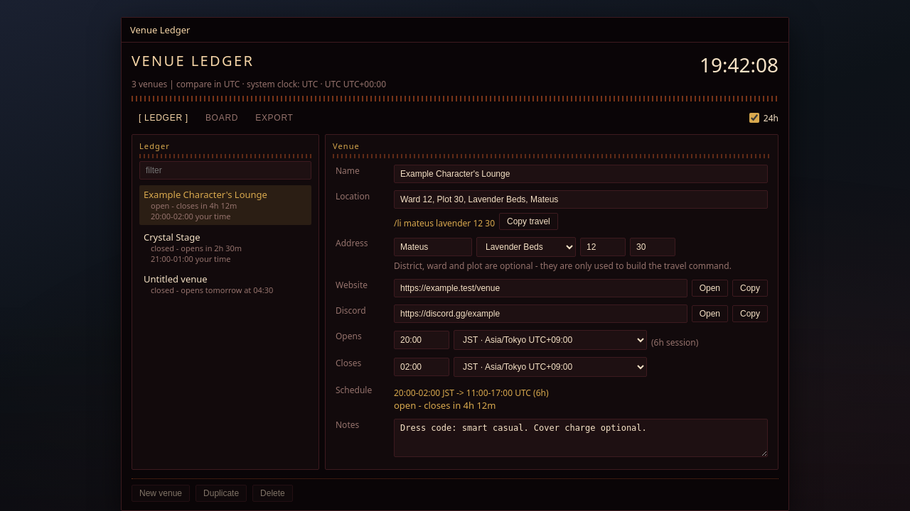
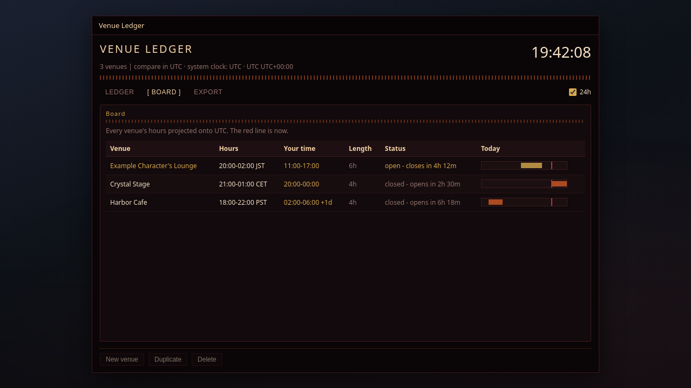
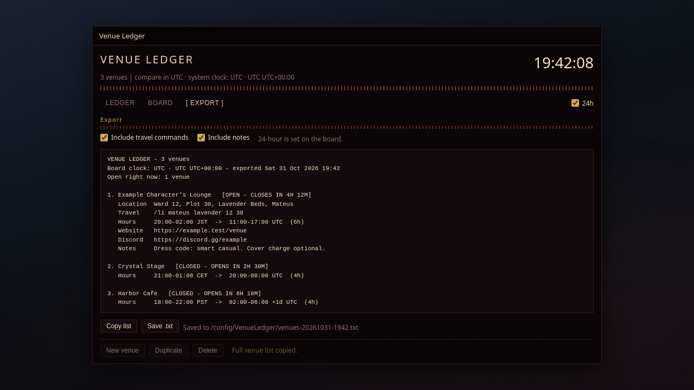
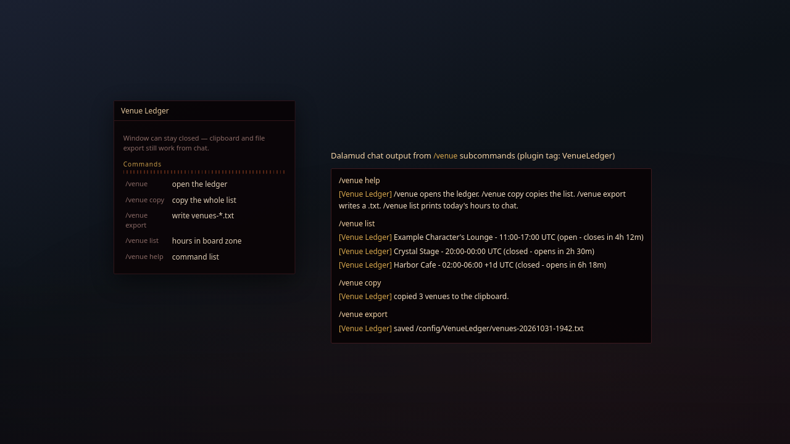
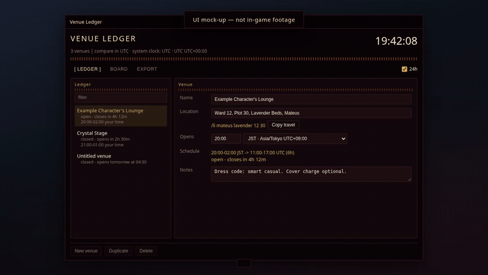

# Venue Ledger


Keeps FFXIV venues in one ledger and reads their hours against your own clock, for anyone tracking a
schedule across timezones.

`/venue` · Dalamud API 15 · .NET 10

## Screenshots

Screenshots are mock-ups illustrating the UI, not captures from the live game.

| | |
| --- | --- |
|  | **Ledger tab** — filterable list, open/closed status, full venue editor (fields, Lifestream travel, links, hours, schedule summary, notes), and footer actions. |
|  | **Board tab** — all venues on one board clock with Hours / Your time / Length / Status columns and the **Today** day strip (crimson line = now). |
|  | **Export tab** — include travel/notes toggles, live preview, **Copy list** / **Save .txt**, and flash feedback. |
|  | **`/venue` commands** — `/venue help`, `/venue list`, `/venue copy`, and `/venue export` messages in chat (works with the window closed). |

Regenerate PNGs from the HTML sources: `cd docs/screenshots/src && npm install && npx playwright install chromium && node render.mjs`.

### Mock-up video

These clips are **HTML mock-ups**, not recordings from the live game (same as the screenshots above).



[Download mockup-walkthrough.mp4](docs/videos/mockup-walkthrough.mp4) (1280×720, ~38s)

Regenerate: `cd docs/videos/src && npm install && npx playwright install chromium && node render.mjs`.

### Feature coverage (mock-ups)

| Feature | Screenshot |
| --- | --- |
| Header ticking clock + `system clock: …` hint | 01, 02, 03 |
| Venue count + `compare in …` (board zone) | 01, 02, 03 |
| **24h** checkbox (12/24-hour board times) | 01, 02, 03 |
| Tabs: **Ledger** / **Board** / **Export** | 01 / 02 / 03 |
| Ledger **filter**, selectable list, open/closed + countdown | 01 |
| Editor: Name, Location, Address (world / district / ward / plot), Website & Discord **Open** / **Copy** | 01 |
| Opens & Closes (wall clock + per-field timezone combo), **Schedule** row | 01 |
| **Copy travel** / Lifestream `/li …` preview | 01, 03 |
| **Notes** field | 01, 03 |
| Board table + **Today** day strip (session bar + now line) | 02 |
| Export: **Include travel commands**, **Include notes**, preview, **Copy list**, **Save .txt** | 03 |
| Footer: **New venue**, **Duplicate**, **Delete** (confirm step is in-window only) | 01 |
| `/venue`, `/venue copy`, `/venue export`, `/venue list`, `/venue help` | 04 |
| Config file only (no in-window UI): `BoardZone`, `NewVenueZone` | *(documented under Settings below)* |

## What it does

| Field | What it does |
| --- | --- |
| **Name** | the venue's label in the list and the export |
| **Location** | free text shown to readers, e.g. `Ward 12, Plot 30, Lavender Beds, Mateus` |
| **Address** | optional world / district / ward / plot, used to build a **Lifestream** command |
| **Website** | with Open (game browser) and Copy |
| **Discord** | with Open and Copy |
| **Opens** | wall clock + **its own timezone selector** |
| **Closes** | wall clock + **its own timezone selector** |
| **Notes** | anything else (dress code, cover charge, age limit) |

- **Header clock** — reads system time and system timezone, ticking every frame
  (`system clock: JST · Asia/Tokyo UTC+09:00`).
- **One board clock** — every venue's hours are projected onto it, so `20:00–02:00 JST` and
  `21:00–01:00 CET` sit next to each other as `12:00–18:00` and `05:00–09:00 +1d` on a board set to
  UTC. The venue's own clock is never thrown away — both are shown.
- **Opening and closing each carry their own timezone**, so a venue that opens in JST and closes in
  another zone still resolves to a real instant; a close that lands before the open instant reads as
  the next day, which is how `20:00 – 02:00` works.
- **Open / closed right now**, with `closes in 4h 12m` or `opens tomorrow at 04:30`.
- **A day strip per venue** on the Board tab: a 24-hour bar with each session drawn in and a crimson
  line at *now*, so overlaps are visible without arithmetic.
- **Lifestream travel**: given district, ward and plot the plugin builds the command Lifestream's own
  help documents — `/li lavender 1 30`, or `/li mateus lavender 12 30` across worlds — and copies it
  in one click.
- **Output**: the Export tab previews the exact text, then copies it to the clipboard or writes
  `venues-YYYYMMDD-HHmm.txt` next to the plugin config.

## How it works

- `Venue.cs` and `Schedule.cs` reference no Dalamud type: the record, districts, timezones, parsing,
  sessions, status, board and exporter all live there, and the offline harness compiles them as-is.
- A venue stores the wall clock as typed (`20:00`, `8pm`, `2000`) and parses it on every read, so
  nothing stale is baked into a row.
- The board clock is `BoardZone` in the config; empty means your system timezone, the same clock as
  the header.

## Commands

| Command | Effect |
| --- | --- |
| `/venue` | open the ledger |
| `/venue copy` | copy the whole list to the clipboard |
| `/venue export` | write the list to a `.txt` and report the path in chat |
| `/venue list` | print each venue's hours in the board zone to chat |
| `/venue help` | the command list |

## Settings

- **Header** — `24h` switches every board time between 24- and 12-hour.
- **Export tab** — whether the output carries the Lifestream command and the notes.
- **Config file** — `BoardZone` (empty = system timezone) and `NewVenueZone` (the zone a new venue
  starts in, empty = system). Neither has an in-window picker.
- **Theme** — smoke `#0a0507`, wine `#3d1a1f`, ember `#d05a26`, cream `#f6e2c6`, gold `#d9a94e`, with
  dotted rules instead of solid separators and square corners. Colours are pushed with `ImRaii`
  around this window's widgets only — **your global Dalamud style is untouched**, and nothing is

## Build

Requires the .NET 10 SDK and the Dalamud dev distribution
(`%APPDATA%\XIVLauncher\addon\Hooks\dev`, or `DALAMUD_HOME`).

```
dotnet build -c Debug      # load bin/Debug/VenueLedger.dll as a dev plugin
dotnet build -c Release    # zip in bin/Release/VenueLedger/latest.zip
```

## Install (dev plugin)

1. `/xlsettings` → Experimental → Dev Plugin Locations → add `bin\Debug\VenueLedger.dll`.
2. `/xlplugins` → Dev Tools → enable **Venue Ledger**.
3. `/venue` opens the window. There is no `/venue config`; settings are in the window.

## Tests

`tools/LogicTests` compiles `Venue.cs` and `Schedule.cs` from the plugin by path, so it runs the real
logic with no game and no dev distrib:

```
dotnet run --project tools/LogicTests -c Release          # 173 checks
dotnet run --project tools/LogicTests -c Release -- --show # a real export, printed
```

The sweep at the end of the harness covers 1,764 zone/time combinations (6 zones × 6 zones × 7 opening
times × 7 closing times) and asserts each one produces a session that closes after it opens, stays under
26 hours and converts to the same instant in every zone.

## Limits

- Lifestream's plot form covers houses. Apartments and FC rooms have no documented `/li` ward-plot
  form, so for those leave the structured address empty and the button copies the location text
  instead.
- District keywords follow Lifestream's documented examples (`lavender`, `goblet`, `mist`) plus
  `shirogane` and `empyreum`.
- The plugin reads no game memory, hooks nothing and executes no teleport. It writes one config file
  and, when you ask, one text file.

## Layout

```
Plugin.cs          entry point, commands, clipboard queue, export file
MainWindow.cs      the window: Ledger / Board / Export
Theme.cs           palette, dotted rules, ImRaii push scoped to this window
Configuration.cs   persisted venues + preferences
Venue.cs           the venue record, districts, Lifestream command building   (no Dalamud)
Schedule.cs        timezones, parsing, sessions, status, board, exporter      (no Dalamud)
tools/LogicTests/  offline harness that compiles the two files above
```
